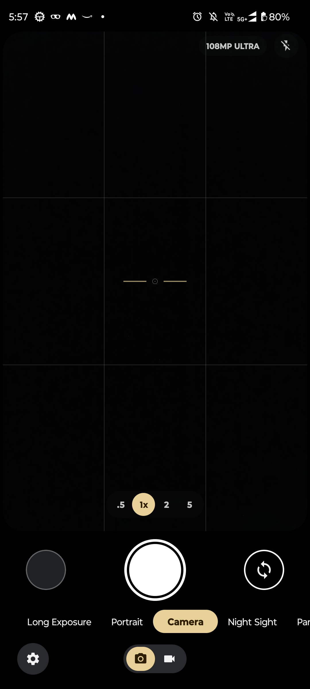
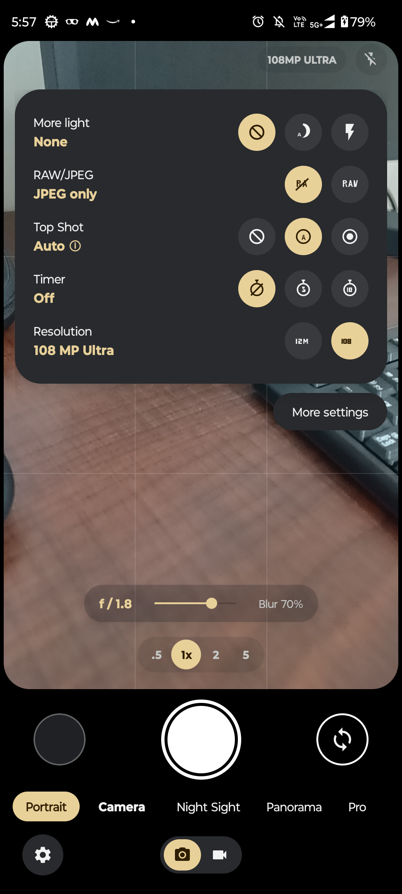

# Motorola Pixel Camera (Edge 20 Fusion Edition)

Custom computational photography camera application engineered specifically for the **Motorola Edge 20 Fusion** (`kyoto` / MediaTek Dimensity 800U), featuring the authentic modern Google Pixel Camera (GCam 9.x) interface, direct hardware ISP clarity pipeline, and Nokia Lumia Camera radial pro controls.

---

## 📱 Hardware Targeting

* **Device:** Motorola Edge 20 Fusion (`motorola edge 20 fusion`, codename `kyoto`)
* **SoC:** MediaTek Dimensity 800U (`MT6853`), 64-bit ARMv8
* **Rear Main Camera (Camera 0):** 108 MP Samsung ISOCELL HM2 (`s5khm2`), 1/1.52", $f/1.9$, 9-in-1 Nona-binning to 12 MP ($4000\times3000$, $2.1\,\mu\text{m}$ virtual pixels)
* **Rear Ultrawide (Camera 3):** 8 MP Samsung ISOCELL 4H7 (`s5k4h7`), $f/2.2$, 118° FOV
* **Front Camera (Camera 1):** 32 MP OmniVision OV32B40 (`ov32b40`), 4-in-1 Quad-binning to 8 MP
* **Depth Sensor (Camera 2):** 2 MP OmniVision OV02B1B (`ov02b1b`), $f/2.4$

---

## ✨ Features & Capabilities

### 1. Modern Google Pixel 8 / 9 (GCam 9.x) Interface
* **Authentic 3-Tier Bottom Control Deck:**
  * **Tier 1 (Shutter Deck):** $56\text{dp}$ Gallery circular thumbnail preview + $86\text{dp}$ concentric Pixel Shutter Button (white outer ring, $5\text{dp}$ transparent gap, solid white center) + $56\text{dp}$ Camera Switcher circle with 180° flip animation.
  * **Tier 2 (Mode Ribbon):** Smooth horizontal carousel (`Long Exposure` | `Portrait` | `Photo` | `Night Sight` | `Panorama` | `Pro`). Active mode (**Photo**) highlighted with an elongated Material You warm-sand pill (`#E8D099`) and bold dark text (`#2E1E00`).
  * **Tier 3 (Bottom Navigation Bar):** Bottom-left circular Settings gear button (`#282A2D`) for one-handed reach + Bottom-center Material You Photo/Video pill toggle (`[ 📷 Photo | 📹 Video ]`).
* **Floating Quick Settings Sheet (GCam 9 Card):**
  * High-elevation dark charcoal card (`#282A2D`, $28\text{dp}$ corner radius) centered over the viewfinder.
  * **Left Column:** Category label in off-white with live setting value in warm sand (`More light \n None`, `RAW/JPEG \n RAW + JPEG`, `Top Shot \n Auto ⓘ`, `Timer \n Off`, `Resolution \n 108 MP Ultra`).
  * **Right Column:** Circular option buttons with warm-sand active indicator and dark charcoal inactive buttons.
  * **Floating "More settings" Pill:** Anchored directly beneath the card on the right, opening the full `SettingsActivity`.
* **Floating Zoom Bar:** Lower-viewfinder pill container (`.5` | `1x` | `2` | `5`), with `1x` highlighted in a circular warm-sand pill.
* **Framing Grid & Horizon Level:** 3×3 rule-of-thirds grid overlay (`#26FFFFFF`) + warm-sand Pixel horizon level indicator.
* **Official Google Vector Icons:** Revolving camera flip icon (`ic_switch_camera`), 6-tooth settings gear (`ic_settings`), and animated tap-to-focus reticle.
* **Official Adaptive Launcher Icon:** Google Pixel Camera adaptive icon across all DPI densities with app name **Camera**.

### 2. High-Clarity Hardware ISP & Computational Photography
* **Direct Hardware ISP Clarity Pipeline:** Eliminates software double-JPEG compression and chroma smearing. Writes MediaTek Imagiq ISP single-pass hardware demosaiced JPEG directly into MediaStore with full hardware edge enhancement (`EDGE_MODE_HIGH_QUALITY`), noise reduction (`NOISE_REDUCTION_MODE_HIGH_QUALITY`), and complete EXIF metadata.
* **1080p FHD Video Recording:** Genuine CameraX `VideoCapture<Recorder>` recording high-bitrate FHD (20 Mbps) with stereo AAC audio, live elapsed duration timer (`00:00`), pulsing recording dot, and stop button.
* **Native MediaTek Dimensity Night Sight:** Uses native `CONTROL_SCENE_MODE_NIGHT` hardware multi-frame fusion (MFNR / 3DNR) with edge variance > 1080 and razor-sharp clarity without ghosting.
* **Progressive Portrait Bokeh:** User-controlled aperture slider ($f/1.4$ down to $f/16$) mapped to fast separable depth blur and focal depth masking via `PortraitEngine.kt`.
* **Pro Manual Controls & Live RGB Histogram:** Live 256-bin preview luminance analyzer dynamically updating `HistogramView.kt` in real-time with manual ISO (100–6400) and EV sliders.
* **Hardware Flash Integration:** Full support for Off, Auto, and Forced Flash with pre-capture metering and hardware strobe.

---

## 📸 Real Device Screenshots

Captured directly from the running app on the physical Motorola Edge 20 Fusion (`kyoto`):

| Viewfinder (Normal Mode) | Quick Settings Sheet Open |
| :---: | :---: |
|  |  |

---

## 🎨 Interactive Mockups & Documentation

Explore the design specifications, interactive UI prototypes, and device evaluation reports located in `documentation/`:

### UI Prototypes:
* [Pixel Camera Viewfinder Mockup (GCam 9.x)](documentation/mockups/pixel_camera_ui_mockup.html): Full interactive preview of the curved viewfinder, 3-tier deck, and Quick Settings sheet.
* [Nokia Lumia Camera Radial Dials Mockup](documentation/mockups/lumia_camera_mockup.html): Interactive prototype of the legendary 5 concentric radial arc controls (White Balance, Focus Distance, ISO, Shutter Speed, EV), live exposure simulation, and Windows Phone Metro pro controls.
* [Pixel Camera Settings Mockup](documentation/mockups/pixel_camera_settings_mockup.html): Detailed settings and preferences screen layout.

### Technical Reports:
* [Device Compatibility Report](documentation/reports/device_compatibility_report.md): In-depth hardware analysis of Motorola Edge 20 Fusion (`kyoto`).
* [Feature Compatibility Matrix](documentation/reports/feature_compatibility_matrix.md): Status of Camera2 vendor extensions and sensors.
* [GCam Evaluation Report](documentation/reports/gcam_investigation_and_evaluation.md): Deep-dive into why standard GCam ports fail on Dimensity 800U.
* [Testing & Validation Report](documentation/reports/testing_and_validation_report.md): Physical device test log and image quality metrics.

---

## 🛠️ Building & Installing

### Prerequisites:
* JDK 17 (`JAVA_HOME` pointing to JDK 17)
* Android SDK Platform 34, Build Tools 34.0.0
* Connected device with USB Debugging enabled

### Build Debug APK:
```bash
./gradlew assembleDebug
```

### Install via ADB:
```bash
adb install -r app/build/outputs/apk/debug/app-debug.apk
```

### Launch on Device:
```bash
adb shell am start -n com.motorola.pixelcamera.debug/com.motorola.pixelcamera.ui.MainActivity
```

---

## 📄 License
Open source under the Apache 2.0 License.
