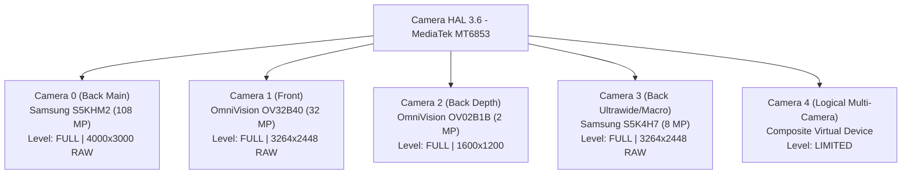

# Hardware & Camera2 Compatibility Report
**Device:** Motorola Edge 20 Fusion  
**Codename:** `kyoto` (`kyoto_retailpf`)  
**Inspection Date:** 2026-11-09  
**Host Connection:** USB ADB (Authorized)

---

## 1. System & Platform Profile

| Parameter | Detected Value | Notes / Significance |
| :--- | :--- | :--- |
| **Manufacturer** | `motorola` | Lenovo / Motorola Mobility |
| **Model** | `motorola edge 20 fusion` | Dual-SIM 5G Global Variant |
| **Hardware Platform** | `mt6853` / `MT6853V/TNZA` | MediaTek Dimensity 800U 5G (7nm) |
| **CPU Architecture** | 8 cores (2x Cortex-A76 @ 2.4 GHz + 6x Cortex-A55 @ 2.0 GHz) | ARMv8.2-A 64-bit |
| **GPU** | ARM Mali-G57 MC3 | OpenGL ES 3.2 (v1.r32p1), Vulkan 1.1 |
| **Total System RAM** | **5.76 GB (6 GB physical)** | 5,763,092 kB recorded in `/proc/meminfo` |
| **OS Version** | **Android 13** | SDK 33 (`ro.build.version.release=13`) |
| **Build Security Patch** | 2024 / Retail PF Channel | Stock Motorola MyUX firmware |

---

## 2. Sensor Identifiers & Physical Characteristics

Discovered via low-level Camera HAL driver query (`com.lenovo.moto.sensor.info.name`):

### Detailed Sensor Matrix

| Camera ID | Role / Lens | Driver Sensor String | Physical Sensor Model | Active Array Size | Max Native Output |
| :--- | :--- | :--- | :--- | :--- | :--- |
| **ID 0** | Rear Main Wide | `mot_s5khm2_mipi_raw` | **Samsung ISOCELL HM2** | `4000 x 3000` | 12 MP (9-in-1 Nona-Binning) / 108 MP Remosaic |
| **ID 1** | Front Selfie | `mot_ov32b40_mipi_raw` | **OmniVision OV32B40** | `3264 x 2448` | 8 MP (4-in-1 Quad-Binning) / 32 MP |
| **ID 2** | Rear Depth Helper | `mot_ov02b1b_mipi_raw` | **OmniVision OV02B1B** | `1600 x 1200` | 2 MP Depth / Range Map |
| **ID 3** | Rear Ultrawide / Macro | `mot_s5k4h7_mipi_raw` | **Samsung ISOCELL 4H7** | `3264 x 2448` | 8 MP Native Ultra-Wide |
| **ID 4** | Logical Multi-Camera | `mot_logical` | Composite (ID 0 + ID 3) | `4000 x 3000` | Dynamic lens switching |

---

## 3. Optical, Exposure & Stabilization Capabilities

| Property | Camera 0 (Main HM2) | Camera 1 (Front OV32B) | Camera 3 (Ultrawide S5K4H7) |
| :--- | :--- | :--- | :--- |
| **Hardware Level** | **`FULL`** | **`FULL`** | **`FULL`** |
| **Focal Length** | 5.88 mm (~26mm eq.) | 3.75 mm (~24mm eq.) | 1.66 mm (~13mm ultra-wide eq.) |
| **Aperture** | `f/1.9` | `f/2.2` | `f/2.2` |
| **ISO Sensitivity** | **100 – 19,200** | 100 – 16,000 | 100 – 16,000 |
| **Shutter Speed (HAL)** | **0.1 ms – 200 ms** (100μs – 0.2s) | 0.1 ms – 200 ms | 0.1 ms – 200 ms |
| **Manual Sensor Control** | Yes (`MANUAL_SENSOR`) | Yes (`MANUAL_SENSOR`) | Yes (`MANUAL_SENSOR`) |
| **Manual Post Processing** | Yes (`MANUAL_POST_PROCESSING`)| Yes (`MANUAL_POST_PROCESSING`)| Yes (`MANUAL_POST_PROCESSING`)|
| **Optical Stabilization (OIS)**| Not equipped (`0`) | Not equipped (`0`) | Not equipped (`0`) |
| **Electronic Stabilization (EIS)**| **Supported** (`MODE_ON`) | **Supported** (`MODE_ON`) | **Supported** (`MODE_ON`) |

---

## 4. RAW Stream & Resolution Combinations

### Camera 0 Stream Support
* **`RAW_SENSOR` (Format 32 / 0x20):**
  * Resolution: **`4000 x 3000`** (12 MP 10-bit Bayer RGGB).
  * Direct uninterrupted burst stream available for multi-frame HDR stacking.
* **`YUV_420_888` (Format 35 / 0x23):**
  * Resolutions: `4000x3000`, `4000x2250`, `3840x2160`, `3264x2448`, `1920x1080`, `1280x720`, down to `160x96` (35 modes).
* **`JPEG` (Format 33 / 0x100):**
  * Up to `4000x3000` at 100% encoder quality.
* **Stream Combinations:**
  * Supported simultaneously: `Preview Surface (YUV/Texture)` + `RAW_SENSOR Capture` + `MediaCodec Encoder`.

---

## 5. Video Recording & Hardware Encoders

| Codec | Driver / Implementation | Max Resolution & Framerate | Capabilities |
| :--- | :--- | :--- | :--- |
| **HEVC (H.265)** | `c2.mtk.hevc.encoder` / `OMX.MTK.VIDEO.ENCODER.HEVC` | 4K UHD (3840x2160) @ 30 FPS | Hardware accelerated, 10-bit profile |
| **AVC (H.264)** | `c2.mtk.avc.encoder` / `OMX.MTK.VIDEO.ENCODER.AVC` | 4K UHD @ 30 FPS / 1080p @ 60 FPS | High Profile Level 5.1 |
| **Slow Motion** | Camera HAL high-speed burst | 1080p @ 120 FPS / 720p @ 240 FPS | Hardware constrained by ISP pipeline |

---

## 6. Vendor Extensions & Proprietary Tags

The Motorola MediaTek camera HAL exposes 10 vendor keys:
1. `com.lenovo.moto.remosaic.sensor.scenarioid` — Triggers high-resolution 108 MP remosaicing.
2. `com.lenovo.moto.sensor.info.quad_pixel` — Flag indicating nona/quad binned sensor array.
3. `com.lenovo.moto.sensor.info.pixel_type` — Pixel layout configuration.
4. `com.lenovo.moto.sensor.info.arcsoft_dual_calib_blob` — Calibration matrix for dual-camera depth mapping with ArcSoft algorithms.
5. `com.lenovo.moto.sensor.info.exposureTimeRange` — Extended manual exposure override for long exposures.
6. `com.mediatek.available.zsl.modes` — Zero Shutter Lag hardware pipeline trigger.
7. `com.mediatek.early.notification.support` — Fast frame delivery notification.

---

## 7. Conclusions & Compatibility Assessment
* **Computational Photography Suitability:** **Excellent**. All 3 imaging cameras (Main 108MP, Selfie 32MP, Ultrawide 8MP) support **`FULL`** Camera2 hardware level with raw Bayer streams and per-frame exposure control.
* **Best Native Resolution:** `4000 x 3000` (12 MP binned RAW). This sensor mode provides the lowest read-noise floor and highest dynamic range, making it ideal for multi-frame HDR+ and Night Sight stacking.
