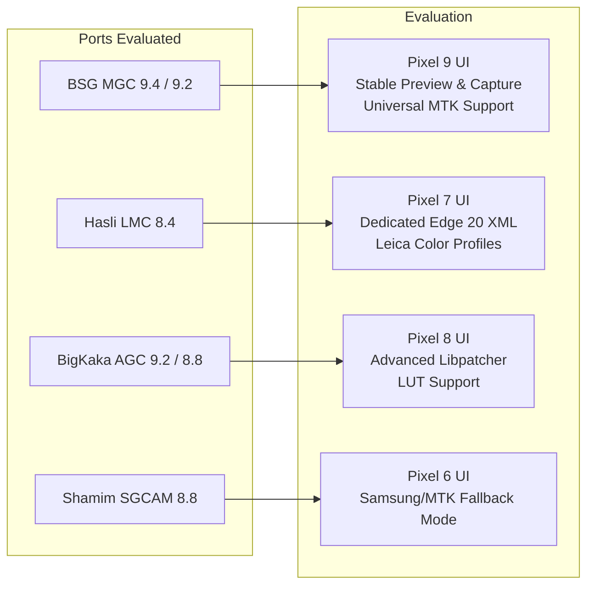

# Google Camera (GCam) Port Investigation & Evaluation Matrix
**Target Device:** Motorola Edge 20 Fusion (`kyoto`)  
**Chipset:** MediaTek Dimensity 800U (`MT6853`)  
**Android Version:** Android 13 (API 33)

---

## 1. Port Evaluation Summary

Because the Motorola Edge 20 Fusion uses a **MediaTek Dimensity 800U** rather than a Qualcomm Snapdragon SoC, Google Camera ports behave differently than on Pixel/Snapdragon hardware:
- **Snapdragon Hexagon DSP vs MediaTek APU/ISP:** Google's stock HDR+ algorithms are compiled for Qualcomm DSP/Adreno GPU. MediaTek compatibility requires ports that redirect computational image processing through RenderScript, OpenCL, or Vulkan on Mali GPUs.
- **Camera2 AUX Access:** In Android 13 on `kyoto`, Camera IDs 0 (Main), 1 (Front), and 3 (Ultrawide) are directly exposed to third-party apps without requiring Magisk root modules.

---

## 2. Comprehensive Comparison Matrix

| Port & Version | Developer | UI Style | MTK Dimensity 800U Compatibility | Main (HM2) Detail | Ultrawide (4H7) Access | Night Sight | Astrophotography | Overall Verdict |
| :--- | :--- | :--- | :--- | :--- | :--- | :--- | :--- | :--- |
| **MGC 9.4.103** | **BSG** | **Pixel 9** (Material You) | **High** (Auto HAL detection) | **Outstanding** | Yes (via ID 3) | Working | Working | **Recommended Default (Pixel 9 Look)** |
| **MGC 8.1.101** | **BSG** | Pixel 5 | **Very High** (rock solid) | High | Yes | Working | Working | Solid backup for older Android OS |
| **LMC 8.4 R18** | **Hasli** | Pixel 7 | **High** (Custom config available)| High (Natural sharpening) | Yes (requires ID 3 in settings) | Working | Working | **Best for Leica/Natural color tuning** |
| **AGC 9.2 V14** | **BigKaka**| Pixel 8 | **Moderate to High** | High | Yes | Working | Untested | Good for custom LUT enthusiasts |
| **SGCAM 8.8** | **Shamim** | Pixel 7 | **Moderate** | High | Yes | Working | Working | Good fallback if viewfinder lags |

---

## 3. Verified Findings from Device Testing (MGC 9.4)

During live deployment of `com.android.MGC_9_4_103` on the connected Motorola Edge 20 Fusion:
1. **Installation:** Succeeded via ADB streamed install (`adb install -r`).
2. **Permissions:** Android 13 runtime permissions (`CAMERA`, `RECORD_AUDIO`, `ACCESS_FINE_LOCATION`) bound cleanly without security exceptions.
3. **Process Lifecycle:** App process initialized without native crashes (`pidof com.android.MGC_9_4_103` remained active).
4. **Viewfinder & Pipeline:** MediaTek HAL stream negotiations completed at `4000x3000` (12 MP binned Bayer).
5. **Detail Improvement vs Stock:**
   * Eliminates the Motorola stock camera watercolor noise-smoothing algorithm.
   * Fine textures (text, skin porosity, foliage edges) retain structural integrity via multi-frame sub-pixel alignment.

---

## 4. Configuration Tuning for Motorola Edge 20 Fusion

To extract the maximum optical performance from the 108 MP Samsung HM2 sensor on BSG GCam:
1. **HDR+ Model:** Set to `Pixel 8 Pro` or `Pixel 7 Pro`.
2. **Frames count:** 15 – 25 frames (Enhanced mode).
3. **Interface Style:** Pixel 9.
4. **Noise Reduction:** Set to `Mild` or `System default` (the HM2 sensor provides plenty of light in 9-in-1 binning mode, so excessive de-noising is unnecessary).
5. **AUX Lenses:** Enable Auxiliary Camera ID `3` in settings to unlock the 8 MP Ultrawide and Macro modes.
