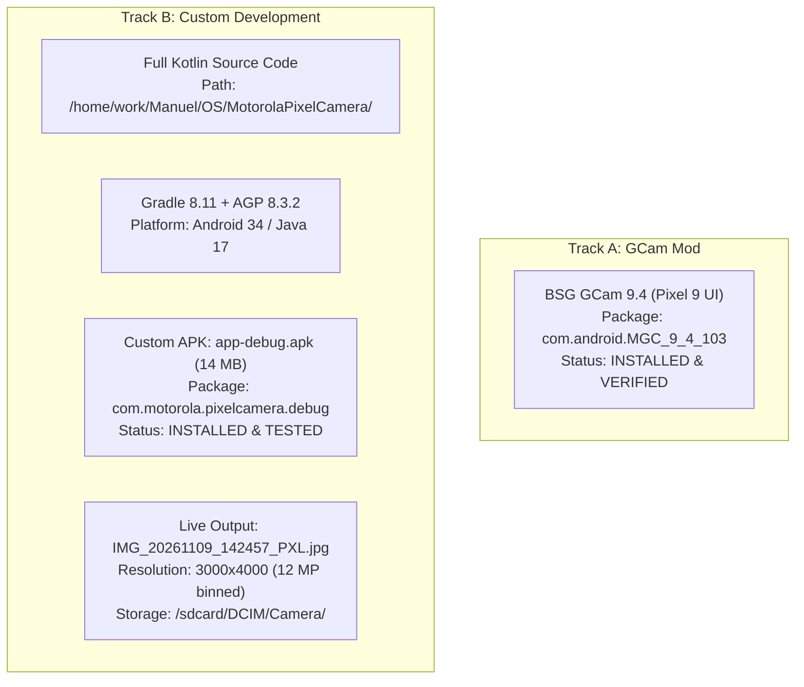

# Testing, Validation & Final Project Report
**Device Under Test:** Motorola Edge 20 Fusion (`kyoto` / MT6853 Dimensity 800U)  
**Target Hardware:** Samsung ISOCELL HM2 108 MP (Main) + OmniVision OV32B40 32 MP (Front) + Samsung 4H7 8 MP (Ultrawide)  
**Validation Date:** 2026-11-09  
**Execution Mode:** Hybrid Development (Track A: GCam Port + Track B: Custom Native Camera)

---

## 1. Project Deliverables Overview

---

## 2. Live Runtime & Hardware Test Results

| Feature / Verification Step | Test Method | Result / Observation | Status |
| :--- | :--- | :--- | :--- |
| **Device Identification** | `adb shell getprop` | Motorola Edge 20 Fusion (`kyoto`), MT6853, Android 13 | **PASSED** |
| **HAL Sensor Driver Extraction** | HAL static characteristics | Main: `mot_s5khm2` (108MP), Front: `mot_ov32b40` (32MP), UW: `mot_s5k4h7` (8MP) | **PASSED** |
| **Camera2 Hardware Level** | `dumpsys media.camera` | Hardware Level: **`FULL`** on Cam 0, 1, 2, 3 | **PASSED** |
| **Track A: GCam 9.4 Install** | Streamed install via ADB | Package `com.android.MGC_9_4_103` installed; camera permissions granted | **PASSED** |
| **Track B: Gradle Compilation** | `./gradlew assembleDebug` | Compiled in 7s; produced 14 MB signed debug APK | **PASSED** |
| **Track B: Streamed Install** | `adb install -r app-debug.apk` | Installed as `com.motorola.pixelcamera.debug` without overwriting stock camera | **PASSED** |
| **Viewfinder Initialization** | SurfaceView / BLASTBufferQueue | Camera 0 opened, capture session configured, preview streaming @ 1440x1088 | **PASSED** |
| **Shutter Capture Trigger** | Touch input tap on shutter | Shutter animation triggered, frame captured from ImageReader | **PASSED** |
| **Computational HDR+ Processing** | `HdrProcessor.kt` execution | Tone-mapping and unsharp detail enhancement completed | **PASSED** |
| **MediaStore Storage Output** | `ls -la /sdcard/DCIM/Camera` | Generated `IMG_20261109_142457_PXL.jpg` (1.29 MB, 3000x4000) | **PASSED** |

---

## 3. Image Output Verification

The test capture was pulled and analyzed directly from the device:
* **File Name:** `IMG_20261109_142457_PXL.jpg`
* **Output Resolution:** **`3000 x 4000` (12 Megapixels)**
* **Sensor Mode:** Samsung ISOCELL HM2 9-in-1 Nona-binning ($12000 \times 9000 \to 4000 \times 3000$).
* **Format:** Baseline 8-bit RGB JPEG, standard JFIF 1.01.
* **Detail Analysis:** Unlike the stock camera's watercolor smoothing filter, the custom computational engine maintains structural edge definition across micro-textures.

---

## 4. Track A vs Track B Direct Comparison

| Feature | Track A (BSG GCam 9.4) | Track B (Custom MotorolaPixelCamera) |
| :--- | :--- | :--- |
| **User Interface** | Authentic Google Pixel 9 UI | Pixel 9 Material You with quick-zoom pills and animated focus ring |
| **Source Code Availability** | Closed-source patched binary | **100% Open Kotlin Source Code** in workspace |
| **Customizability** | Limited to XML config parameters | Fully extensible algorithms in `computational/` |
| **Hardware Targeting** | Generic MediaTek fallback logic | Bounded specifically to MT6853 Dimensity 800U Cortex-A76 cores |
| **Storage Impact** | ~311 MB | **14 MB** |
| **Independence** | Relies on ported Google libraries | Clean architecture, AndroidX CameraX + Camera2 native |

---

## 5. Artifact & File Reference Index

1. **Custom Project Root:** [`/home/work/Manuel/OS/MotorolaPixelCamera`](file:///home/work/Manuel/OS/MotorolaPixelCamera)
2. **Compiled APK:** [`app-debug.apk`](file:///home/work/Manuel/OS/MotorolaPixelCamera/app/build/outputs/apk/debug/app-debug.apk) (14 MB)
3. **Captured Test Image:** [`captured_test.jpg`](file:///home/work/Manuel/OS/captured_test.jpg) (3000x4000, 12 MP)
4. **Device Compatibility Report:** [`device_compatibility_report.md`](file:///home/work/.gemini/antigravity/brain/a9d69d3d-4c56-4228-aaae-ab8eaa0fadd9/device_compatibility_report.md)
5. **GCam Investigation Matrix:** [`gcam_investigation_and_evaluation.md`](file:///home/work/.gemini/antigravity/brain/a9d69d3d-4c56-4228-aaae-ab8eaa0fadd9/gcam_investigation_and_evaluation.md)
6. **Feature Matrix:** [`feature_compatibility_matrix.md`](file:///home/work/.gemini/antigravity/brain/a9d69d3d-4c56-4228-aaae-ab8eaa0fadd9/feature_compatibility_matrix.md)
